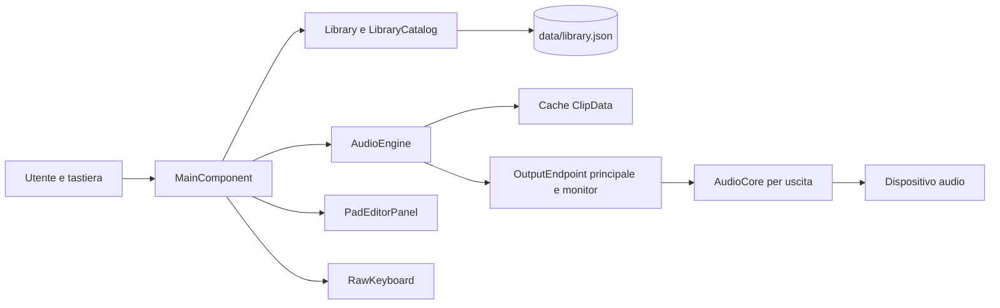

# DualDeck JUCE 0.7 — documentazione del codice

Aggiornamento riverbero del27ottobre: quattro diffusori allpass wet-only
si aggiungono ai quattro comb; il feedback è smorzato con un polo a6kHz.
Buffer e offset sono preparati in `AudioCore::prepare`, cursori e stati
filtrati appartengono alla voce, celle validate con la sua epoch. La coda
riserva tempo anche ai diffusori. Diretto, mix e limiter restano quelli
descritti sotto. Dettagli e verifiche in [VERIFICHE-RIVERBERO.md](Changelogs/VERIFICHE-RIVERBERO.md).

Questa guida descrive **l'implementazione presente nei sorgenti**, con l'obiettivo di aiutare chi deve comprenderla, correggerla o estenderla. Il [LEGGIMI](LEGGIMI.md) resta la guida d'uso; [EDITOR-UI](EDITOR-UI.md) tratta l'editor visivo di debug. Il progetto è una soundboard desktop C++17 basata su JUCE 9.0.4. Il prodotto è destinato soprattutto a Windows x64: la tastiera dedicata e la decodifica Media Foundation dipendono da API Windows.

## 1. Mappa del progetto

| File | Responsabilità |
| --- | --- |
| [CMakeLists.txt](CMakeLists.txt) | Configura C++17, JUCE, applicazione, opzione per l'editor UI e test CTest. |
| [Source/Main.cpp](Source/Main.cpp) | Avvio JUCE, finestra, argomenti di verifica e modalità di esecuzione. |
| [Source/MainComponent.h](Source/MainComponent.h), [Source/MainComponent.cpp](Source/MainComponent.cpp) | Coordinamento dell'interfaccia, comandi dell'utente, dispositivi e job audio/scansione. |
| [Source/LibraryWorkflow.cpp](Source/LibraryWorkflow.cpp) | Salvataggi in background, chiusura sicura, rinomina e rimozione dei profili. |
| [Source/PadPressState.h](Source/PadPressState.h) | Modalità fissata alla pressione per rilasciare correttamente i loop anche dopo una modifica del pad. |
| [Source/PadPlayback.cpp](Source/PadPlayback.cpp) | Pressioni dei pad, precaricamento, scorciatoie, loop e stop globale. |
| [Source/PadEditor.h](Source/PadEditor.h), [Source/PadEditor.cpp](Source/PadEditor.cpp) | Editor di tagli, forma d'onda ed effetti di un pad. |
| [Source/Library.h](Source/Library.h), [Source/Library.cpp](Source/Library.cpp) | Modello di profili/pad, caricamento e salvataggio JSON, compatibilità tra schemi. |
| [Source/LibraryCatalog.cpp](Source/LibraryCatalog.cpp) | Scansione cartelle, riconciliazione dei file, ricerca, ordinamento e pagine. |
| [Source/AudioCore.h](Source/AudioCore.h) | Mixer e DSP nel callback audio; voci, comandi, effetti, limiter. |
| [Source/SpectralScrub.h](Source/SpectralScrub.h), [Source/PhantomScrub.h](Source/PhantomScrub.h) | Scrub ibrido con testina phantom allineata alle onde e sintesi spettrale a fasi coerenti a velocità zero. |
| [Source/AudioEngine.h](Source/AudioEngine.h), [Source/AudioEngine.cpp](Source/AudioEngine.cpp) | Apertura delle uscite, ingresso microfono, decodifica, cache PCM e inoltro al mixer. |
| [Source/WindowsDecoder.cpp](Source/WindowsDecoder.cpp) | Decoder di ripiego tramite Media Foundation. |
| [Source/RawKeyboard.h](Source/RawKeyboard.h), [Source/RawKeyboard.cpp](Source/RawKeyboard.cpp), [Source/KeyboardFilter.h](Source/KeyboardFilter.h) | Raw Input Windows e filtraggio per dispositivo e ripetizioni. |
| [Source/UiLayoutEditor.h](Source/UiLayoutEditor.h), [Source/UiLayoutEditor.cpp](Source/UiLayoutEditor.cpp) | Sovrapposizione di debug per spostare/ridimensionare controlli; compilata solo su richiesta. |
| [Tests](Tests) | Test DSP e tastiera, verifiche della libreria e sonda separata per l'isolamento dei dispositivi. |

La dipendenza principale è direzionale: l'interfaccia usa libreria, tastiera e motore audio; `AudioEngine` usa `AudioCore` e il modello delle impostazioni; `Library` usa `VoiceSettings` come dati ma non apre dispositivi. Questa separazione permette di verificare il DSP senza avviare la GUI.



## 2. Avvio e ciclo di vita

`DualDeckApplication` in `Main.cpp` interpreta la riga di comando. Nell'uso normale crea `DeckWindow`, che ospita `MainComponent` dentro un `juce::Viewport`: la finestra può restringersi fino a 960 × 640 e l'area interna scorre se necessario. I percorsi di test sono gestiti nello stesso punto d'ingresso; l'app consente più istanze soltanto per i comandi di verifica previsti.

Il costruttore di `MainComponent` trova la radice del progetto con `findProjectRoot()`, determina `data/library.json`, carica la libreria oppure crea un profilo iniziale. Se un file esistente non si carica, `writable` diventa falso: la GUI resta disponibile per diagnosticare il problema e i salvataggi ordinari sono sospesi, così il JSON danneggiato non viene sovrascritto. Il componente registra i callback dei controlli, inizializza l'elenco dei dispositivi e avvia i lavori necessari per il profilo selezionato. La sua distruzione attende i worker e chiude le uscite; le callback asincrone verso la GUI usano `juce::Component::SafePointer` per evitare di accedere a un componente già distrutto.

`MainComponent` è il coordinatore applicativo. Le operazioni che cambiano `Library`, la selezione o i widget si concludono sul **message thread** JUCE. Le attività costose sono affidate a cinque `juce::ThreadPool` distinti, ciascuno con un worker: caricamento richiesto dalla pressione di un pad, precaricamento, scansione cartelle, generazione della forma d'onda e salvataggio. I job comunicano i risultati alla GUI con `juce::MessageManager::callAsync`. Questo confine è importante: una scansione o una decodifica non deve modificare direttamente componenti o vettori dei pad da un thread di lavoro.

## 3. Modello dei dati e persistenza

`Library` contiene i profili, l'indice del profilo attivo, la modalità di riproduzione predefinita, i livelli master, i nomi dei dispositivi, le opzioni del microfono, il pitch globale e l'identificatore della tastiera. Un `Profile` contiene ID, nome, cartelle collegate, ordinamento e vettore di `Pad`. Un `Pad` possiede ID, nome, percorso del file, associazione a un tasto, preferito e `VoiceSettings`. Conserva inoltre dimensione, data di modifica e stato di disponibilità del file: ordinamento e disegno non ripetono letture del filesystem.

L'ID del pad è persistente e identifica l'oggetto nelle operazioni della GUI. Il numero `#1`, `#2`, ecc. è il rango nell'ordinamento completo selezionato per il profilo, comprese direzione e parità stabili. `padDisplayNumbers()` restituisce la mappa dall'indice memorizzato al numero visualizzato; `MainComponent` e la tastiera grafica la aggiornano durante `rebuildTiles()`. Le tile mantengono separati `index` per le azioni e `displayNumber` per la presentazione. Ricerca, preferiti e pagine per cartella conservano i numeri dell'intero profilo; `orderedPads()` applica la ricerca `#numero` dopo l'ordinamento completo. Nel percorso di riproduzione `MainComponent::triggerPad()` usa ancora `index + 1` come ID numerico della voce; l'ordinamento di visualizzazione non modifica il vettore, le associazioni o le voci attive. Quando invece una scansione elimina pad e può cambiare gli indici memorizzati, il coordinatore ferma le riproduzioni prima di continuare.

### Formato JSON

`Library::save()` scrive lo **schema 10**. `Library::load()` accetta gli schemi **3–10** e rifiuta quelli fuori intervallo. Il JSON ha proprietà generali come `SchemaVersion`, `ActiveProfileId`, `DefaultMode`, dispositivi e volumi, più un array `Profiles`; ogni profilo contiene `Folders` e `Pads`. Le impostazioni del pad sono serializzate come campi del singolo oggetto, per esempio `TrimStart`, `FilterMix`, `ReverbMix` e `OverrideMasterVolume`. I valori percentuali salvati come 0–100 vengono convertiti in 0–1 in memoria. `requestedAtNs` serve soltanto alla misura di latenza durante l'esecuzione e non è serializzato.

I percorsi interni alla radice del progetto vengono salvati in forma relativa alla cartella `data`; quelli esterni restano assoluti. `LocalMedia` permette il recupero controllato di vecchi file locali nella cartella `sounds`. Il caricamento ripara ID di profilo o pad duplicati, elimina associazioni di tasti duplicate o riservate e limita i parametri numerici agli intervalli previsti. Per gli schemi precedenti applica valori predefiniti ai nuovi effetti e converte i vecchi controlli filtro/eco; il volume individuale globale dei vecchi schemi viene trasferito ai pad. Questa logica è concentrata in `Library::load()` e va aggiornata insieme a ogni cambiamento dello schema.

Il salvataggio crea prima un file temporaneo. Se `library.json` esiste, ne copia una versione `.bak`; solo dopo sostituisce il file principale. Se il backup fallisce, il salvataggio è annullato. `MainComponent::save()` in `LibraryWorkflow.cpp` consegna al worker una **copia coerente** di `Library`, numerata con una generazione. Una nuova modifica rimpiazza lo snapshot ancora in attesa; il worker scarta snapshot superati prima di scriverli. Gli errori ritornano al message thread e lasciano la libreria marcata come modificata per un nuovo tentativo. Rinomina e rimozione aggiornano il modello senza attendere il disco; la chiusura aspetta che l'ultima generazione sia salvata e, se fallisce, permette di riprovare.

### Cartelle collegate

`scanAudioFolders()` percorre ricorsivamente le cartelle senza seguire collegamenti simbolici. Considera WAV, MP3, FLAC, OGG, AIFF, M4A, AAC e WMA; la presenza di un'estensione non garantisce che il codec possa decodificare il contenuto. La scansione si ferma a 100.000 audio scoperti o 1.000.000 file visitati, può essere annullata e segnala le cartelle non disponibili. Usa un percorso normalizzato, senza differenza tra maiuscole e minuscole su Windows, per non creare due pad dello stesso file anche in cartelle sovrapposte.

`Library::mergeFolderScan()` aggiunge i nuovi file e aggiorna i metadati dei pad esistenti. Un file assente viene marcato con `fileMissing`, conservando il pad e tutti i suoi dati anche dopo una scansione completa. Quando lo stesso percorso torna disponibile, viene riattivato il pad esistente senza creare un nuovo ID o ripristinare i valori predefiniti. Le impostazioni restano serializzate anche durante l'assenza, quindi sopravvivono alla chiusura dell'app. Percorsi diversi, anche con lo stesso nome file, restano distinti e richiedono un ricollegamento esplicito. `orderedPads()` restituisce indici filtrati/ordinati; `folderPadPages()` raggruppa tali indici per directory fisica e li divide in pagine da 24, conservando gli indici originali.

## 4. Percorso di riproduzione

1. Un `PadTile`, la vista tastiera o `RawKeyboard` porta un evento a `MainComponent::triggerPad()` attraverso i rispettivi handler.
2. Il coordinatore prende le impostazioni del pad, applica l'eventuale modalità globale, valida file e taglio, e costruisce una **revisione** da data di modifica e dimensione del file.
3. Se il prefisso è pronto, `AudioEngine::playPrepared()` mette un comando in coda. In caso contrario il pad entra in `pendingPads` e `playbackLoader` chiama `preparePlaybackClip()` fuori dal message thread. Ulteriori pressioni dello stesso pad durante la preparazione sono accorpate. L'editor usa ancora `loadClip()` e `playCached()` per il clip completo.
4. Al termine, la callback sul message thread controlla la generazione di riproduzione, lo stato di pressione del loop tenuto e la validità del componente. Solo allora usa `playReserved()`; altrimenti rilascia la prenotazione del clip.
5. Ogni `OutputEndpoint` aperto riceve il comando nel proprio `AudioCore`. Il callback del dispositivo consuma i comandi, aggiorna le voci, produce due canali float e aggiunge eventualmente il microfono.

`PadPressState` conserva la modalità della pressione iniziale: il rilascio di un loop premuto ferma la voce anche se la modalità del pad è stata modificata nel frattempo. `stopAll()` svuota questo stato insieme alle richieste pendenti.

`stopAll()` incrementa `playGeneration`, svuota le pressioni pendenti e chiama `AudioEngine::stop()`. Un job di decodifica già in corso può finire, ma la sua callback vede la generazione vecchia e non avvia il suono. Nel mixer `AudioCore::stop()` incrementa una generazione atomica: al successivo callback le voci sono liberate e i comandi appartenenti alla generazione precedente vengono scartati, rilasciando i riferimenti ai clip. Se un dispositivo è chiuso e non può più consumare la coda, `resetAfterDeviceStop()` libera esplicitamente voci e comandi residui.

### Cache e proprietà dei clip

`ClipData` contiene campioni float **stereo intercalati** oppure una sorgente `StreamedPcm`. Il percorso dei pad prepara soltanto 500 ms dal taglio iniziale, con prefissi limitati complessivamente a 96 MiB. `StreamingAudio` legge il resto in pagine da 8192 frame: quattro worker indipendenti dividono un pool massimo di 64 MiB. Ogni sorgente rimane assegnata allo stesso worker, dove il decoder viene aperto, usato e distrutto; questo conserva l'affinità COM/Media Foundation. JUCE legge i formati nativi, `WindowsStreamReader` fornisce il ripiego Windows. Ogni richiesta accoda soltanto la pagina assente più vicina, per distribuire il lavoro fra le voci; il mixer anticipa mezzo secondo. Le pagine acquisite sono protette dal ricambio con riferimenti atomici fino al termine del callback. La coda usa riferimenti deboli, così i lavori obsoleti non trattengono prefissi espulsi. Se mancano dati la testina attende; un errore permanente ferma la sorgente e permette una nuova preparazione.

L'editor usa ancora il percorso completo `loadClip()`, con una cache LRU separata da 384 MiB per waveform, anteprima e scrub. La memoria audio esposta è la somma di questa cache, prefissi e pagine; non coincide con tutta la memoria del processo. Entrambi i percorsi accettano file più lunghi limitando la lettura ai primi 180 secondi, senza modificare gli originali. `activeReferences` protegge i clip usati da voci, comandi o prenotazioni; si espellono soltanto clip senza riferimenti attivi. `MainComponent::preloadProfile` prepara il profilo in tutte le viste, con priorità ad associazioni e pagina visibile, un solo job, snapshot e generazione di annullamento. Il caricamento dei pad premuti resta separato.

La chiave della cache completa è `percorso|revisione`; quella dei prefissi include anche il taglio iniziale. Una scansione che aggiorna data e dimensione identifica una nuova versione. Lo streaming controlla questi metadati anche prima dell'apertura del decoder: se il file è cambiato o manca, segnala l'errore. Le parti già lette restano in memoria; il file originale deve restare disponibile per leggere le successive. Se cambiano i byte ma entrambi i metadati restano identici, non esiste un segnale per invalidare la cache.

### Mixer ed effetti

`AudioCore` ha una coda a produttore singolo e consumatore singolo (`CommandQueue<256>`) tra message thread e callback audio. Ogni endpoint ha fino a **32 voci**. In mancanza di uno slot libero viene sostituita la voce più vecchia, proteggendo l'eventuale voce di scrub dell'editor. Le modalità dei pad sono `restart` (sostituisce la voce dello stesso pad), `overlap` (sovrappone), `toggleLoop` e `holdLoop`; `scrub` è usata soltanto dall'anteprima dell'editor. Il rilascio di `holdLoop` applica la dissolvenza di uscita; i loop toggle si fermano alla successiva attivazione dello stesso pad. Per le copie in `overlap`, il callback raggruppa le voci per ID del pad e confronta l'energia del loro mix con quella della copia più forte. La radice del guadagno di compensazione dimezza la correzione in dB, lasciando aumentare moderatamente il livello delle copie. Quando resta una sola copia il target torna a uno, senza usare la precedente energia del gruppo; i boost oltre uno vengono rimossi immediatamente. La correzione graduale agisce sul gruppo prima della somma degli altri pad e del limiter finale; il numero di voci e le code degli effetti restano invariati. La correzione non ricostruisce un segnale annullato da opposizione di fase perfetta.

Le impostazioni della voce sono copiate all'avvio. Il mixer applica tagli, dissolvenze, velocità e ricampionamento lineare; la velocità del pad e il pitch globale influiscono insieme su intonazione **e durata**. I parametri per voce comprendono passa basso, passa alto, distorsione, tremolo, compressore, delay, ping-pong, chorus e riverbero. La dissolvenza del file agisce prima degli effetti temporali, evitando che la coda torni bruscamente al livello pieno a fine file; il rilascio esplicito sfuma tutta la voce. Delay, ping-pong e riverbero normalizzano l'ingresso del feedback per `1 - feedback`; il mix aggiunge soltanto il wet, senza dividere il diretto per `1 + mix`. Le code degli effetti in serie si sommano; il delay raggiunge -80 dB invece di fermarsi dopo otto ripetizioni. Il segnale delle voci è sommato, poi è aggiunto l'eventuale microfono e infine agisce il limiter stereo a 0,98: riduzione immediata sui picchi, mantenimento di circa 25 ms riarmato vicino ai picchi e recupero con costante di tempo di circa 40 ms. Il guadagno del limiter usa doppia precisione per evitare che il recupero si arresti prematuramente a 96/192 kHz; nessun lookahead o ritardo aggiuntivo. `prepare()` alloca i buffer degli effetti prima dell'avvio del callback; `render()` non esegue allocazioni, I/O su file, mutex o lavoro GUI.

La revisione successiva del 27 ottobre limita la ricerca PCM a una griglia iniziale di circa 48 confronti più raffinamento locale. In `SpectralScrub` i bin classificati rumorosi evolvono indipendentemente, con fase condivisa tra i canali; il phase locking resta nelle regioni tonali. Questo aggiorna il raggruppamento descritto nella sezione dello scrub sotto. Le misure e i limiti percettivi e temporali sono in [VERIFICHE-AUDIO-REVIEW.md](Changelogs/VERIFICHE-AUDIO-REVIEW.md).

I master delle due uscite e il pitch globale sono target atomici con transizione graduale durante `render()`. Un pad con `overrideMasterVolume` usa il proprio gain al posto del master dell'uscita. Gli altri parametri del pad si applicano alle **nuove** voci: modificare l'editor non riscrive le voci già in esecuzione. `lastOnsetLatencyMs()` misura il tempo tra richiesta del pad e trattamento del comando nel callback; non misura la latenza fisica del dispositivo o del percorso verso altre applicazioni.

### Dispositivi e microfono

`AudioEngine::configure()` apre l'uscita principale e, se richiesta e diversa, quella monitor. Se la seconda apertura fallisce chiude anche la principale. Se i nomi coincidono usa una sola uscita, quindi non duplica l'audio. Ogni dispositivo mantiene callback e clock propri: le due uscite ricevono gli stessi comandi, ma non c'è sincronizzazione campione per campione fra dispositivi distinti. Su Windows `OutputEndpoint` usa WASAPI condiviso, preferisce 48 kHz quando disponibile e richiede due canali d'uscita attivi.

Quando è abilitato, l'ingresso fisico è letto nel callback dell'uscita principale e miscelato con i suoni. `MicrophoneRing` trasferisce i campioni al callback dell'eventuale monitor con un piccolo buffer, interpolazione e correzione limitata della deriva fra clock. Il livello del microfono ha un controllo separato dai master dei suoni. L'implementazione consente di ascoltare la voce anche in cuffia senza aprire due volte l'ingresso.

## 5. Tastiera e interfaccia

La vista pad, la vista della tastiera grafica e la scheda della tastiera dedicata condividono i dati di `Library`. `rebuildTiles()` calcola la ricerca, i preferiti, l'ordinamento e le pagine; `selectPad()` aggiorna l'ispettore. I tile hanno azioni mouse e tastiera e un `AccessibilityHandler`; la tastiera grafica ha navigazione con frecce, attivazione e assegnazione. Il campo di ricerca viene differito di 150 ms per i profili grandi.

Con la tastiera dedicata disattivata, Raw Input passa gli scan code fisici a `MainComponent::handleLocalKey()`, che applica focus, esclusione dei campi di testo e navigazione dei controlli. `keyStateChanged()` rilascia i tasti locali quando il focus viene perso. `KeyboardScan.h` distingue tastierino e navigazione, normalizza Bloc Num e Stamp, ed emette Pausa come impulso; `PhysicalKeyboardInput` segue le transizioni di ciascun dispositivo anche in secondo piano per ignorare le ripetizioni al ritorno del focus. Raw Input serve anche a riconoscere con F12 l'interfaccia selezionata; `KeyboardDeviceIdentity.h` converte il percorso esatto nell'istanza PnP e SetupAPI restituisce il primo HardwareID. `RawKeyboard` avvia `KeyboardBridge`, che lancia lo stesso eseguibile come broker figlio senza finestra. Il broker carica dinamicamente la DLL ufficiale verificata, esige un solo slot con HardwareID completo uguale e filtra soltanto quello. `KeyboardFilterChannel.h` applica SET_FILTER sul relativo handle con conferma del risultato Windows; usa il layout della sola DLL v1.0.1 x64 fissata per hash, perché il driver legacy non implementa GET_FILTER. Il valore zero del getter non viene più trattato come una rilettura valida. Il broker usa la stessa normalizzazione fisica tramite `deliverPhysicalKey()`, mantenendo controlli di sessione e coda anche per il rilascio interno di Pausa. Gli eventi arrivano direttamente ai pad tramite una coda limitata; durante attivazione e cattura i comandi locali sono sospesi. La GUI pubblica l'heartbeat ogni 50 ms; il broker rilascia il filtro dopo 1500 ms senza aggiornamenti, alla chiusura del padre o per errore. `retireCapture` revoca la consegna prima del cleanup, così gli eventi accodati non avviano pad durante il rilascio. Se la GUI è bloccata, il filtro viene rilasciato autonomamente, mentre lo stop dei suoni già avviati attende la ripresa della GUI. L'attivazione reale resta manuale nella build di prova separata. Vedi `TASTIERA-BLOCCO.md`.

`keyboardLayout()` comprende 105 tasti ISO italiani, separatori senza azioni e tasti su due righe. `KeyboardView` usa una scala comune alle righe, hitbox senza sovrapposizioni e navigazione che salta i separatori. `keyboardViewport` scorre orizzontalmente sotto 800 pixel; i codici dei tasti esistenti sono invariati. Esc, F12 e il tasto DJ restano riservati.

`PadEditorPanel` espone tagli ed effetti. La forma d'onda viene calcolata solo all'apertura: `waveformLoader` prende un clip dalla cache, ricava fino a 32768 picchi e restituisce il risultato alla GUI. `WaveformDisplay` aggrega i picchi per pixel nella finestra visibile, con zoom fino a 32× e scorrimento orizzontale tramite Maiusc+rotella. I marcatori aggiornano `VoiceSettings`; il salvataggio applica i valori al pad individuato con ID di pad e profilo, poi richiede la persistenza. `UiLayoutEditor` è invece uno strumento di **debug** compilato soltanto con `DUALDECK_UI_EDITOR` in build Debug: sovrappone controlli di spostamento/ridimensionamento alla GUI e salva gli offset del layout, senza attivare i pad mentre si modifica la disposizione.

Lo scrub dell'editor mantiene una sola voce `scrub` per tutta la pressione. Il message thread aggiorna una posizione target atomica su entrambe le uscite, senza accodare nuove voci durante il trascinamento. `SpectralScrub` combina il motore spettrale con la testina virtuale `PhantomScrub`, che legge sempre a velocità locale 1× anche durante il movimento inverso del cursore. Prima di riposizionarsi, la testina cerca entro ±24 ms una porzione compatibile con la continuazione dell'onda in uscita, confrontando i due canali separatamente e applicando lo stesso offset a entrambi. Le letture vengono incrociate con un inviluppo a coseno lungo 512 campioni (circa 10,7 ms a 48 kHz), con compensazione dell'energia in base alla correlazione; non c'è più una giunzione arbitraria di 2 ms a ogni hop. Sugli attacchi la ricerca di allineamento viene esclusa e il raccordo resta di 2 ms per conservare il momento del colpo, con protezione dalle ripetizioni ravvicinate dello stesso attacco.

La parte spettrale usa FFT di 2048 campioni fino a 64 kHz, 4096 fino a 128 kHz e 8192 oltre questa soglia, sempre con hop pari a un quarto della FFT. La durata dell'analisi resta quindi simile sulle uscite comuni a 48/96/192 kHz, conservando la risoluzione delle note basse. L'analisi lavora sulla griglia temporale dell'uscita; ai bordi sposta la finestra all'interno del file quando la lunghezza lo permette e, all'inizio, stima la frequenza con una finestra successiva invece di ripetere il primo campione. I bin vengono raggruppati intorno ai picchi e sintetizzati con fasi relative coerenti; ogni oscillatore condivide la frequenza tra i due canali, conservando le relazioni di fase e livello stereo. Le fasi iniziali sono raccordate alla posizione della testina phantom. Dopo circa 35 ms senza movimento, l'analisi si assesta sul target senza reinizializzare gli oscillatori; l'uscita passa alla sintesi a velocità zero con una dissolvenza a coseno di circa 12 ms. La testina PCM viene riancorata al cursore anche tra eventi del mouse, finché resta udibile. Soltanto sugli attacchi rilevati il PCM rimane in riproduzione libera per circa 50 ms: l'avvio su una nota sostenuta o sul silenzio passa subito verso il freeze. Anche gli spostamenti inferiori a 24 campioni sorgente aggiornano l'analisi e il rilascio del mouse conserva l'ultima coordinata senza la precedente tolleranza di 2 ms. Per salti superiori a 150 ms l'analisi si riposiziona subito e incrocia per circa 20 ms la coda spettrale precedente con quella nuova, gestendo anche un ulteriore salto durante l'incrocio. Il suono fermo combina sintesi spettrale e testina phantom anche dopo il passaggio al freeze. La piattezza spettrale in bande locali determina il contributo PCM: piccolo sui suoni tonali, maggiore sui rumori, limitato quando sono presenti armoniche significative. Nei soli gruppi spettrali rumorosi viene variata la fase, condividendo la variazione tra i canali; i gruppi tonali conservano il phase locking. `PhantomScrub::hold()` varia le letture entro la finestra locale di analisi, riservando spazio per entrambi i lettori del raccordo; sui rumori riduce la ricerca per somiglianza per evitare che si blocchi su un identico ciclo corto. Durante il trascinamento e le pause inferiori a 35 ms resta il precedente percorso di allineamento. Sono euristiche di sintesi, non una separazione esatta tra armoniche e rumore. I buffer FFT e di sintesi sono allocati in `prepare()`; ricerca e sintesi nel callback non allocano memoria né acquisiscono lock.
Il pulsante di anteprima A-B usa un ID riservato e una voce `holdLoop` sui marcatori correnti. **Riproduci file** usa un altro ID per l'intero suono; anche lo scrub usa i valori correnti degli effetti letti dal pannello. Se l'utente trascina la forma d'onda durante questa riproduzione, la voce continua viene rilasciata; al rilascio del mouse riparte dalla posizione selezionata. **Ferma**, chiusura dell'editor e STOP TUTTO arrestano le anteprime dell'editor, mentre **Ferma** non tocca gli altri pad. La casella per usare il loop sul pad cambia la modalità del pad a `toggleLoop` e disattiva l'eventuale eredità della modalità generale solo se l'utente modifica la casella. Non sono aggiunti campi al JSON: A e B riutilizzano `TrimStart` e `TrimEnd`, e la modalità usa i campi esistenti `Mode` e `UseGlobalMode`.

## 6. Compilazione e verifiche

`CMakeLists.txt` richiede CMake 3.22 o successivo, C++17 e JUCE nella cartella `deps/JUCE-9.0.4` o nel percorso indicato con `JUCE_DIR`. La configurazione Windows collega Media Foundation; i target `DualDeckAudioTests` e `DualDeckKeyboardTests` sono registrati in CTest. `DualDeckKeyboardIsolationProbe` è un eseguibile separato su Windows. La guida d'uso descrive il download degli strumenti portatili con `Setup.ps1` e il parametro `-ToolRoot` per riutilizzarli da un'altra copia.

Da PowerShell, nella cartella `juce-version`:

```powershell
.\Build.ps1
.\Test.ps1 -AudioDevices -Performance
```

`Build.ps1` configura una build Release MSVC con Ninja, compila, esegue CTest salvo `-SkipTests` e copia l'eseguibile versionato. `Test.ps1` esegue CTest e le modalità integrate `--self-test`, `--keyboard-smoke`, `--interaction-smoke` e `--smoke-test`; le verifiche dei dispositivi fisici e delle prestazioni sono opzionali. I report e le schermate finiscono in `test-output`. `--self-test` esercita il round trip e le migrazioni della libreria, la scansione, cache/revisioni e un caso del ring microfono. I test DSP in [Tests/AudioTests.cpp](Tests/AudioTests.cpp) e del filtro tasti in [Tests/KeyboardTests.cpp](Tests/KeyboardTests.cpp) non richiedono la GUI. Gli esiti storici sono nei file `VERIFICHE-*.md`: descrivono esecuzioni precedenti, non costituiscono una verifica automatica di ogni modifica successiva.

## 7. Come estendere il codice

**Nuova proprietà per pad.** Aggiungerla a `VoiceSettings`, stabilire un valore predefinito innocuo, esporla in `PadEditorPanel` o nell'ispettore, serializzarla in `Library::save()` e leggerla con migrazione in `Library::load()`. Se cambia il formato, aumentare `SchemaVersion` e aggiornare i test di round trip/compatibilità. Valutare se la proprietà è fissata all'avvio della voce oppure deve agire anche sulle voci già attive.

**Nuovo effetto audio.** Preparare in `AudioCore::prepare()` ogni buffer necessario; inizializzare lo stato di una voce in `apply()`; processare i campioni in `render()` senza allocare o acquisire lock. Verificare code dell'effetto, riuso degli slot voce e comportamento dopo `stop()`. Aggiungere test DSP che osservino un risultato udibile o numerico, non soltanto la copia dei parametri.

**Nuovo formato audio.** Distinguere tre passaggi: riconoscimento dell'estensione in `LibraryCatalog.cpp`, decodifica JUCE o Media Foundation e validazione della durata/memoria in `AudioEngine::loadClip()`. Un file elencato nella GUI ma non decodificabile deve produrre un errore chiaro; non va dato per supportato solo perché è stato trovato durante la scansione.

**Nuovo controllo o flusso GUI.** Registrare il componente e i suoi callback in `MainComponent`, aggiornare `resized()` e la vista appropriata, rispettare il message thread e usare `SafePointer` nelle callback differite. Se il controllo muta la libreria, chiedere `save()` dopo una modifica valida; se muta l'audio in tempo reale, scegliere un canale atomico o un comando che il callback possa leggere senza lock.

## 8. Limiti intenzionali e punti da tenere presenti

- Il blocco per dispositivo è integrato nella build di prova con Interception già installato; il test fisico di soppressione e recupero resta manuale.
- Cambiare velocità o pitch cambia anche la durata; non è implementato un algoritmo di time stretching con pitch indipendente.
- Le uscite audio separate non condividono un clock sincronizzato. La latenza mostrata è quella comunicata dal driver o quella software fino al callback, secondo il contesto.
- La cache è limitata e può rifiutare un clip quando tutte le voci trattenute occupano la memoria. Non è una perdita di dati della libreria.
- I file audio collegati restano nel filesystem originale. La rimozione di un profilo o di un pad cambia la libreria, non elimina i file audio.
- Il JSON dello schema 10 è compatibile in lettura con questa versione e con i suoi schemi precedenti supportati; una versione più vecchia dell'app potrebbe non caricarlo.

Per orientarsi in una modifica, partire dal metodo che riceve l'azione in `MainComponent`, seguire l'eventuale cambio del modello in `Library`, poi il passaggio a `AudioEngine` e `AudioCore`. Questo percorso rende espliciti i punti in cui cambiano thread, proprietà dei dati e durata degli oggetti.


